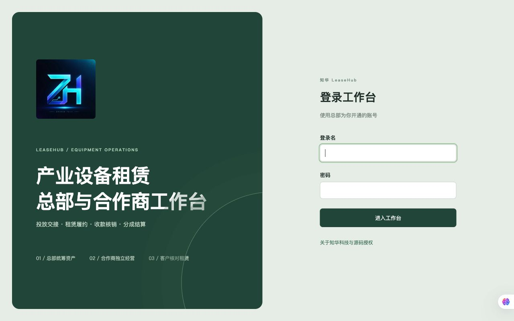
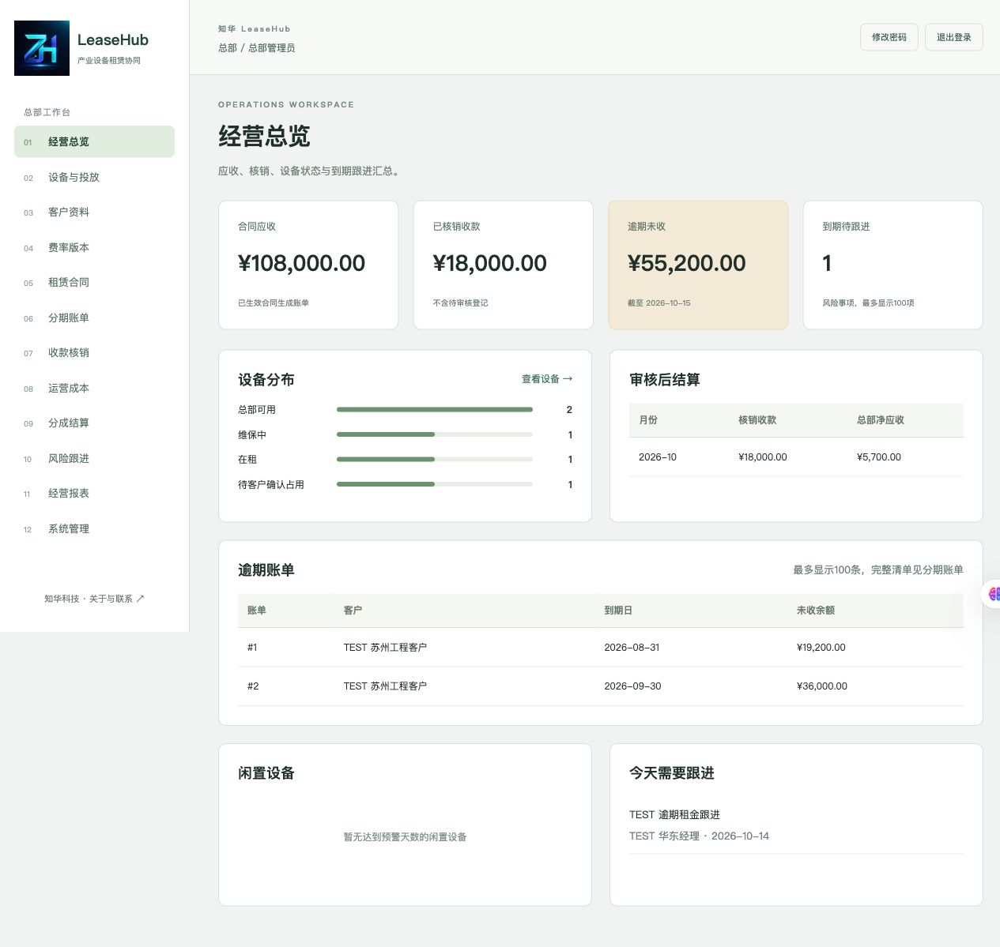
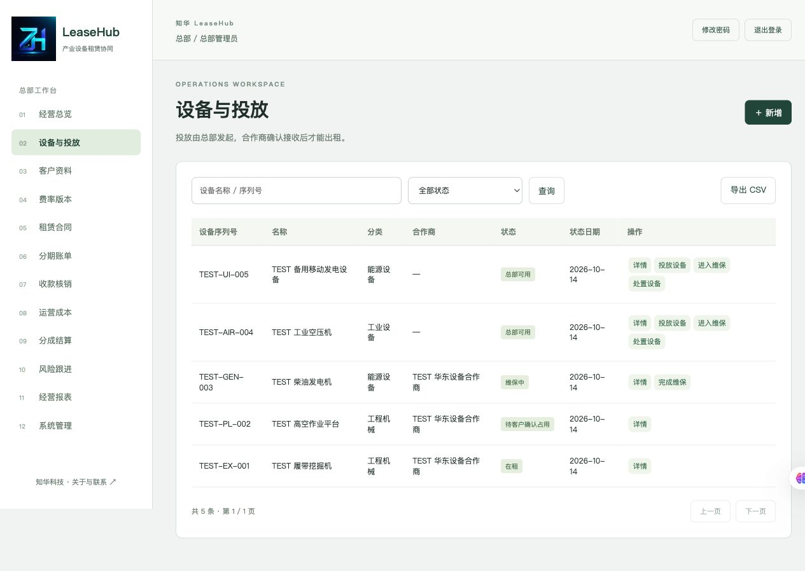
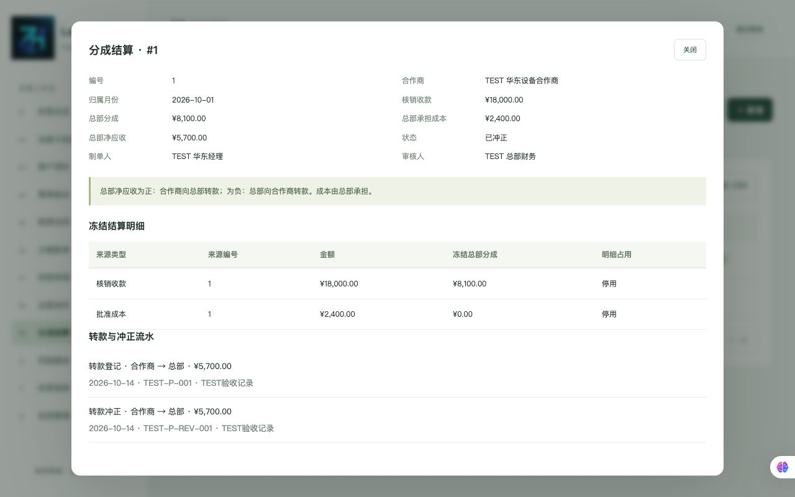
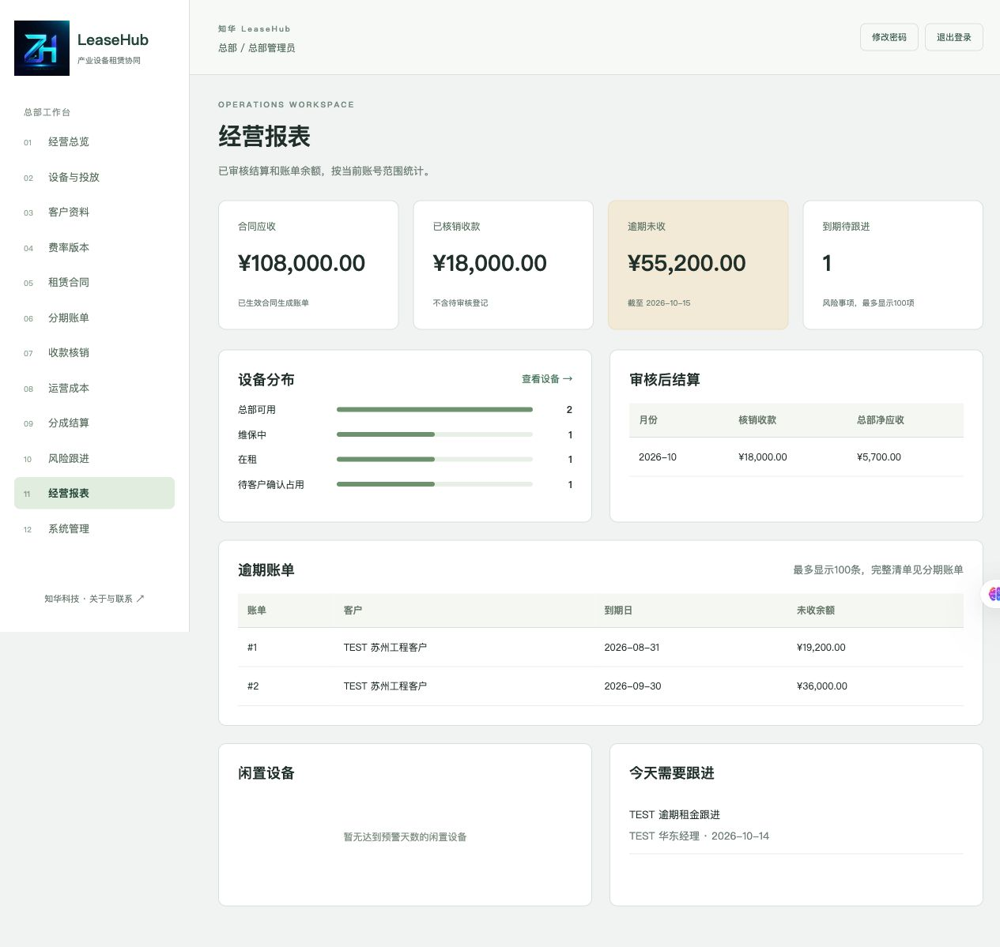
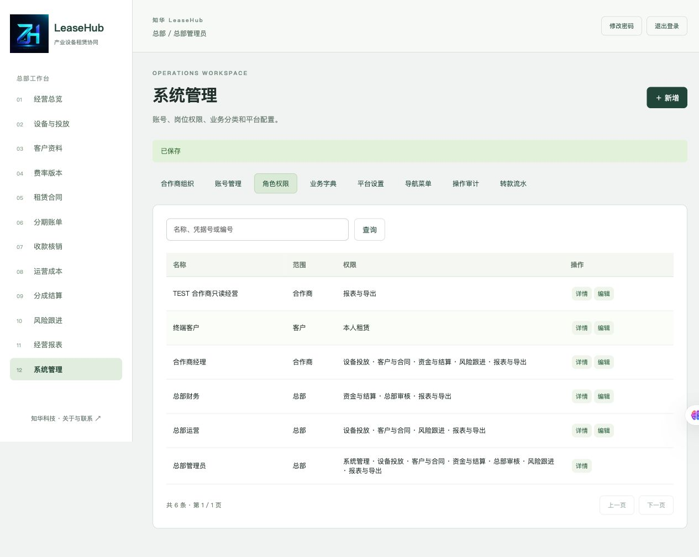
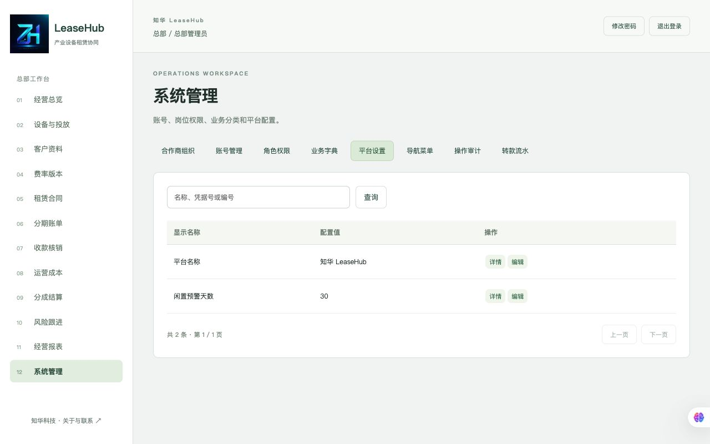
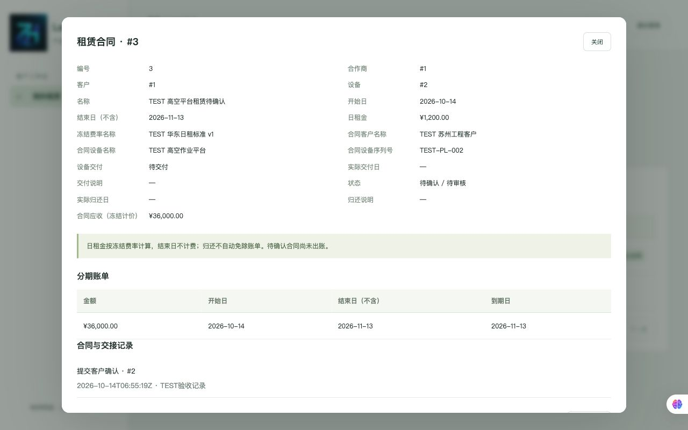
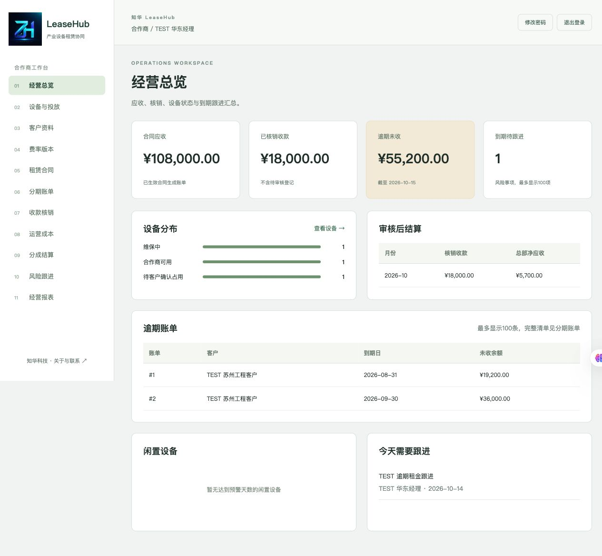

[中文](README.md) | [English](README.en.md)

# 知华科技 LeaseHub · 产业设备租赁总部与合作商运营平台

**知华科技（上海如静知华信息科技有限公司）** · [官网](https://www.zhuatech.cn/)


LeaseHub 面向“总部持有设备、区域合作商投入场地与人员、终端客户使用设备”的经营租赁业务，提供设备投放、双方交接、租赁合同、分期账单、收款核销、成本审核、分成结算与风险跟进。Java 21 / Spring Boot / Vue 3 / MySQL / Flyway / Docker Compose。

**源码公开、非商业使用。仅限个人学习交流，未经上海如静知华信息科技有限公司书面授权不得商用。** 本项目不是允许免费商用的 MIT/Apache 许可项目，亦非 OSI 标准开源许可；自有代码适用 [LICENSE](LICENSE)，第三方组件保留自身许可，见 [NOTICE](NOTICE)。企业私有部署、项目交付和深度定制须另行取得授权。

## 适用场景与工作台

- 总部：产业设备投入方、设备厂商的区域租赁网络、经营租赁业务部门，统一管理设备权属、合作商投放、费率版本、核销与结算审核。
- 合作商：独立管理自己的客户、合同、设备交接、线下收款、运营成本和待跟进事项。
- 终端客户：仅查看自己的合同、冻结计价与分期账单，确认合同、实际设备接收及归还，查询核销结果。

一个总部、多合作商的数据范围隔离，不是多总部 SaaS。适用于学习、评估与经授权的定制基础，不宣称直接满足实际企业生产验收。

## 已实现功能

| 模块 | 业务能力 |
| --- | --- |
| 设备与投放 | 唯一序列号、投入成本、设备分类；总部投放、合作商接收；可用/占用/在租/维保/回收/处置；版本冲突拦截与交接历史 |
| 合同与履约 | 客户/设备/费率归属复核，提交占用设备，客户本人确认；冻结客户名、设备名/序列号、日租金和总部分成；合作商登记交付/归还，客户分别确认 |
| 分期账单 | 按合同开始日逐月分段，日租金乘实际天数；开始日含、结束日不含，最长366天；确认前可看总额和分期预览 |
| 收款核销 | 单账单部分收款、凭据号去重、总部审核、超额拦截、冲正；待审核收款不进入统计 |
| 成本与分成 | 总部承担成本申报/审核；每笔按冻结比例分成并向下取整到分；来源锁定；制单与独立审核；正/负净额方向、手工转款与追加冲正流水 |
| 风险与经营 | 真实逾期未收、闲置设备、到期跟进；负责人、后续日期和跟进历史；已审核结算统计、安全 CSV 导出 |
| 管理与安全 | 机构、客户、账号、同范围自定义角色/权限、菜单、字典、设置、审计；会话、CSRF、BCrypt、登录限流、账号停用及密码失效 |

收款与转款是**人工核实的线下凭据台账**，不会发起或验证银行转账。客户页面确认不是电子签章。风险提醒显示在站内清单，没有邮件、短信或微信推送。

## 真实运行截图

以下页面使用独立 TEST 数据运行，不代表真实客户、收入或成交案例。没有公开密码、密钥或客户资料。

### 登录工作台



### 总部经营总览：应收、核销与到期跟进



### 设备与投放：序列号、合作商及生命周期



### 分成结算：冻结来源与转款冲正历史



### 经营报表：真实账单余额与已审核结算



### 角色权限与平台设置




### 客户端与合作商工作台




## 技术架构与数据

Vue 3.5.43 / Vite 8.1.5 → 同源 Nginx → Spring Boot 4.0.7 / Spring JDBC / Spring Security → MySQL 8.4。Java 21；Flyway 自动迁移。账号、权限和对象归属在后端复核，菜单隐藏不能代替权限校验。

写事务先锁数据库协调行再复核版本和状态，保护设备占用、核销、结算来源一致性。金额为整数分，JSON金额与汇总用十进制字符串输出，前端精确显示；业务日期按 Asia/Shanghai，数据库连接按UTC。会话在应用内存，重启重新登录；业务数据、历史、审计和配置持久化于数据库。

```text
backend/                 Java 21 后端、状态机及测试
  src/main/resources/db/migration/  Flyway版本迁移
frontend/                Vue工作台、请求客户端及测试
  public/brand/          正式LOGO
scripts/                 环境生成、验收、备份/恢复及发布检查
docs/                    业务、架构、接口、操作、安全、部署和验证说明
  images/                两个原始微信二维码
  screenshots/           实际运行截图
compose.yaml             MySQL / 后端 / 前端
compose.storage.yaml     可选独立宿主数据目录
```

## 环境要求与安装启动

Docker Engine + Compose v2，建议6GB以上可用内存、至少10GB空闲磁盘；Python3.12/3.13用于辅助脚本。容器内构建无需宿主Java/Node；源码开发需要Java21、Maven3.9及Node24.19.0。

```sh
python3 scripts/init-env.py
docker compose -p leasehub config --quiet
docker compose -p leasehub up --build -d --wait --wait-timeout 1200
```

网页：`http://127.0.0.1:8162/`；健康：`http://127.0.0.1:8162/actuator/health`。

默认初始账号 `admin`，**密码由脚本随机生成，保存在仅当前用户可读的私有 `.env` 中**。无固定公开密码。脚本拒绝覆盖现有环境文件，已有数据库不重建账号；修改 ADMIN_PASSWORD 环境变量不会重置已有密码。初始系统没有假合作商、客户、设备、合同或收入，先由总部建立组织、客户和账号。

### 数据库初始化与迁移

`backend/src/main/resources/db/migration/V1__leasehub.sql` 首次启动自动建表，初始化管理员、角色、菜单、字典与设置。不需要重复执行手工建表SQL。升级添加新的版本迁移，不能修改已执行迁移或Flyway历史；先备份并演练恢复。首版没有旧客户数据迁移验收。

### 配置说明

见 [.env.example](.env.example)。MYSQL_ROOT_PASSWORD、DATABASE_PASSWORD、ADMIN_PASSWORD只在私有环境中；WEB_PORT/BIND_ADDRESS默认8162/127.0.0.1；COOKIE_SECURE本机HTTP为false，生产HTTPS设true。可选DATABASE_URL/DATABASE_USER连接外部MySQL。业务名称、闲置天数、字典、菜单和费率在后台配置。

默认命名卷跟随Docker数据盘。磁盘较慢时可使用 [部署手册](docs/deployment.md) 的 `compose.storage.yaml` 与专用绝对路径 LEASEHUB_MYSQL_DATA_DIR；不得直接改路径替代已有数据迁移。未提供银行、电子签章或通知服务的密钥配置。

## 测试方式

```sh
mvn -B -f backend/pom.xml spotless:check clean verify
cd frontend
npm ci --no-audit --no-fund
npm run format:check
npm run lint
npm test
npm run build
```

在项目根目录执行脚本检查：

```sh
python3 -m pip install -r scripts/requirements-quality.txt
python3 -m black --check scripts
python3 -m unittest discover -s scripts -p 'test_*.py'
python3 scripts/release-check.py
```

真实接口验收仅用于**全新的独立 TEST 数据库**，会生成TEST机构、账号、合同与资金台账，私有状态文件必须位于仓库外：

```sh
python3 scripts/smoke.py --url http://127.0.0.1:8162 --env-file .env --private-state /absolute/private/leasehub-test-state.json
```

后端23项、前端2项、恢复保护6项检查及真实接口、备份恢复、页面验收的实际结果见 [验证记录](docs/verification.md)。镜像构建执行测试，不跳过 Maven 测试。发布检查需对Git已跟踪/已暂存文件运行；私有环境、生成目录和备份不能入库。

## 部署与使用

生产部署须经授权，在HTTPS、网络隔离、专用账号、可信MySQL CA、备份恢复及实际业务条件下验收。默认仅本机访问，数据库和后端不暴露宿主端口。备份脚本要求显式项目和私有文件；恢复只允许独立 `leasehub-restore-*` 空数据库，拒绝覆盖业务库。

- [业务规则](docs/business.md) · [架构](docs/architecture.md) · [接口](docs/api.md)
- [操作手册](docs/operations.md) · [部署与恢复](docs/deployment.md) · [安全与权限](docs/security.md)

## 已知限制与未实现

- 单总部、单应用实例、低容量部署；写协调会串行化写入，会话不共享，不宣称高并发、多总部SaaS或生产可用性指标。
- 人民币日租金，最长366天；不含融资利息、税务发票、多币种、押金、保险、自动违约金或提前归还退款。归还不自动免除账单。
- 银行/支付、电子签章、财务系统、设备遥测、短信/邮件/微信通知尚未接入；没有定位、资质或信用保证。
- 关联下拉每类最多1000条；CSV最多10000条，按当前账号范围导出全部记录，不沿用页面关键词过滤；预警最多100条。
- 已审核月结算要补录明细时，须按流程先撤销/冲正并重新制单；已转款须先核对真实资金与台账差异。
- 未验收信创数据库、500并发、实际企业历史数据、RPO、审计保留年限、磁盘加密或可用性承诺；宿主存储性能会影响部署及请求延迟。

## 授权与联系知华科技

仅限个人学习交流。未经上海如静知华信息科技有限公司书面授权，不得用于商业项目交付、收费部署、SaaS运营、二次销售或为第三方提供收费服务，具体以 [LICENSE](LICENSE) 为准。源码公开不等于免费商用。

**商业授权或深度定制开发请联系知华科技。**

- 公司：知华科技（上海如静知华信息科技有限公司）
- 官网：[https://www.zhuatech.cn/](https://www.zhuatech.cn/)
- 微信：`zhuatech`、`zhuatech2`
- 服务：商业授权、定制开发、私有部署、系统集成与维护

| 微信 zhuatech | 微信 zhuatech2 |
| --- | --- |
|  |  |
